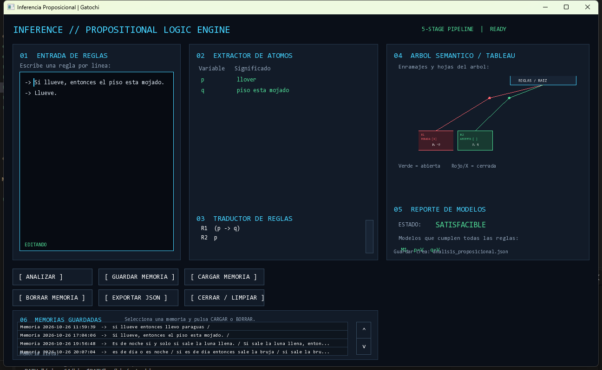
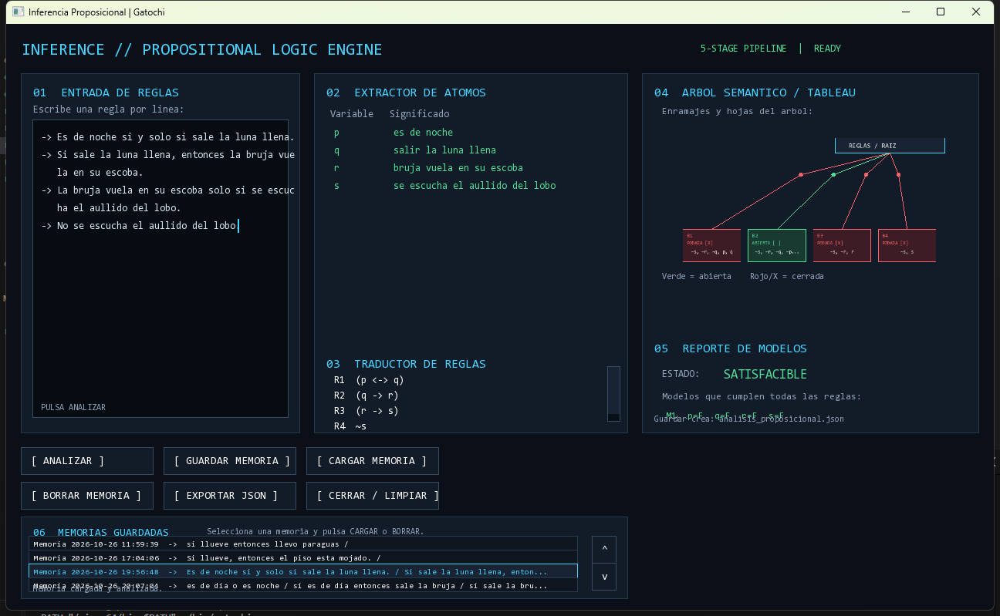

# Gatochi: motor de inferencia proposicional

Motor educativo de inferencia proposicional escrito en C++17 con una interfaz
grafica construida sobre SFML. Permite escribir reglas en espanol, traducirlas
a formulas logicas, explorar el tableau semantico y comprobar si existe al
menos un modelo que satisfaga todas las premisas.

El proyecto esta pensado para aprender **como una frase cotidiana se
convierte en una decision formal**: una rama verde representa una combinacion
posible de hechos; una rama roja se cierra cuando exige un hecho y su negacion
al mismo tiempo.



> La imagen anterior es una captura de la aplicacion compilada y ejecutandose,
> no una maqueta. En ella se ven el editor, los atomos `p` y `q`, las formulas,
> las ramas del tableau, el estado `SATISFACIBLE` y las memorias guardadas.

## Que hace

- Lee una regla por linea desde el editor integrado.
- Normaliza tildes y varias conjugaciones frecuentes para comparar frases como
  `llueve`, `esta lloviendo` y `llovio`.
- Reconoce conectores de logica proposicional en espanol.
- Extrae los atomos y les asigna variables (`p`, `q`, `r`...).
- Muestra la traduccion formal de cada regla.
- Construye un tableau semantico con ramas abiertas y cerradas.
- Enumera los modelos que cumplen todas las reglas.
- Explica al hacer clic por que una rama es satisfacible o por que se contradice.
- Guarda, carga y borra memorias de analisis.
- Exporta el analisis actual a `analisis_proposicional.json`.
- Incluye una suite automatizada de 31 casos.

## Recorrido de una inferencia



Esta segunda captura muestra una entrada mas grande con cuatro reglas, cinco
atomos, varias hojas y memorias seleccionadas. Sirve para observar como la
interfaz se adapta a un analisis que abre y cierra mas de una rama.

### 1. Entrada de reglas

Escribe una premisa por linea. Por ejemplo:

```text
Si llueve, entonces el piso esta mojado.
Llueve.
```

La interfaz conserva la entrada original para que el resultado pueda
entenderse en lenguaje natural.

### 2. Extraccion de atomos

Cada hecho indivisible se convierte en un atomo. En el ejemplo:

```text
p = llover
q = piso mojado
```

Los atomos se comparan por su forma normalizada, no por el tiempo verbal
original.

### 3. Traduccion de reglas

Los conectores se transforman a una formula formal. El ejemplo anterior queda:

```text
p -> q
p
```

Esta etapa permite ver la diferencia entre el texto escrito y la estructura
logica que realmente evaluara el motor.

### 4. Tableau semantico

El motor descompone las formulas y abre ramas cuando una disyuncion o una
equivalencia ofrece alternativas. Una rama se cierra cuando contiene `p` y
`~p`; una rama abierta puede convertirse en un modelo.


Al hacer clic en una hoja:

- **Rama cerrada:** se explica que hechos incompatibles fueron exigidos, por
  ejemplo: `"llover"` y `"no llover"` al mismo tiempo, junto con la regla
  relacionada.
- **Rama abierta:** se enumeran los hechos que pueden cumplirse juntos y se
  indica que no hay una contradiccion entre ellos.

### 5. Reporte de modelos

El estado final es:

- **SATISFACIBLE:** existe al menos una asignacion de verdad que hace
  verdaderas todas las reglas.
- **INSATISFACIBLE:** ninguna asignacion logra cumplirlas todas; todas las
  ramas terminan cerradas.

Por ejemplo, estas premisas son insatisfacibles:

```text
Llueve.
No esta lloviendo.
```

Mientras que estas son satisfacibles:

```text
Si llueve, entonces el piso esta mojado.
Llueve.
```

Un modelo posible es `llover=V, piso mojado=V`.

## Conectores reconocidos

| Idea | Formas de entrada | Formula |
| --- | --- | --- |
| Negacion | `no`, `nunca`, `jamas`, `es falso que`, `es mentira que` | `~p` |
| Conjuncion | `y`, `ademas`, `tambien`, `aunque`, `tanto ... como ...` | `p & q` |
| Disyuncion inclusiva | `o`, `o bien`, `ya sea ... o ...` | `p v q` |
| Disyuncion exclusiva | `o p o q pero no ambos` | `p XOR q` |
| NOR | `ni p ni q` | `~(p v q)` |
| Condicional | `si p entonces q`, `si p, q`, `en caso de que p, q` | `p -> q` |
| Suficiencia | `p es condicion suficiente para q`, `p implica q` | `p -> q` |
| Necesidad | `p solo si q`, `q es condicion necesaria para p` | `p -> q` |
| Bicondicional | `si y solo si`, `equivale a`, `es equivalente a` | `p <-> q` |

La lista completa y los detalles de normalizacion estan en
[docs/gramatica_espanol.md](docs/gramatica_espanol.md). La `o` es inclusiva:
`p o q` tambien permite que ambas sean verdaderas. Para exigir exactamente
una, escribe `pero no ambos`.

## Interfaz

La ventana se divide en seis zonas:

1. **Entrada de reglas:** editor multilinea y botones de analisis.
2. **Extractor de atomos:** relacion entre variables y hechos.
3. **Traductor:** formula formal de cada regla.
4. **Arbol semantico/tableau:** ramas abiertas en verde y cerradas en rojo.
5. **Reporte de modelos:** estado y asignaciones encontradas.
6. **Memorias guardadas:** persistencia, carga, borrado y exportacion.


### Acciones principales

| Accion | Resultado |
| --- | --- |
| `ANALIZAR` | Relee la entrada y actualiza atomos, formulas, ramas y modelos. |
| Clic en una rama | Muestra la justificacion contextual de esa hoja. |
| `GUARDAR MEMORIA` | Guarda la entrada actual en `memorias_guardadas.db`. |
| `CARGAR MEMORIA` | Restaura la memoria seleccionada y la vuelve a analizar. |
| `BORRAR MEMORIA` | Elimina la memoria seleccionada. |
| `EXPORTAR JSON` | Escribe el analisis actual en `analisis_proposicional.json`. |
| `CERRAR / LIMPIAR` | Limpia el estado de trabajo de la interfaz. |

## Requisitos

- C++17.
- GNU Make.
- SFML 2 (`graphics`, `window`, `system` y `audio`).
- En Windows, MinGW-w64/MSYS2 con sus DLL disponibles en el `PATH`.
- Una fuente del sistema: el programa intenta `consola.ttf` y luego
  `arial.ttf` en `C:\Windows\Fonts`.

## Compilar y ejecutar

Desde la raiz del repositorio:

```bash
make build
make run
```

En Windows con MSYS2:

```bash
export PATH="/mingw64/bin:/usr/bin:$PATH"
make run
```

El Makefile ya incorpora el directorio del compilador MinGW al `PATH` de
ejecucion cuando detecta Windows, lo que evita errores por DLL ausentes al
lanzar `gatochi.exe`.

## Ejecutar las pruebas

```bash
make test
```

La suite se define en [test_suite.txt](test_suite.txt) y comprueba:

- conjunciones, disyunciones y negaciones;
- condicionales y bicondicionales;
- necesidad y suficiencia;
- NOR y disyuncion exclusiva;
- normalizacion de verbos;
- deteccion de contradicciones;
- modelos esperados para cada caso.

Salida esperada actual:

```text
31/31 Pruebas pasadas - 100% Accuracy
```

## Manual de usuario

### A. Abrir el programa

1. Instala los requisitos indicados en la seccion anterior.
2. Abre una terminal en la raiz del proyecto.
3. Ejecuta `make run`.
4. Si aparece la pantalla de bienvenida, pulsa Enter o haz clic en
   `[ ENTRAR AL MOTOR ]`.

La aplicacion inicia con un ejemplo de lluvia. Puedes sustituirlo directamente
en el editor o pulsar `[ CERRAR / LIMPIAR ]` para empezar desde cero.

### B. Escribir reglas

Escribe una frase por linea. No es necesario usar `p`, `q` o simbolos
logicos: el traductor trabaja con frases en espanol.

Ejemplo completo:

```text
Si llueve, entonces el piso esta mojado.
Llueve.
```

Pulsa `[ ANALIZAR ]`. El programa:

1. limpia y normaliza el texto;
2. encuentra `llover` y `piso esta mojado`;
3. asigna `p` y `q`;
4. traduce las reglas a `p -> q` y `p`;
5. construye las ramas;
6. calcula los modelos.

El resultado esperado es `SATISFACIBLE`, porque existe una situacion coherente:
llueve y el piso esta mojado.

### C. Leer la pantalla de resultados

#### Extractor de atomos

Relaciona cada variable con el significado de la frase:

```text
p    llover
q    piso esta mojado
```

Dos frases con el mismo significado normalizado usan el mismo atomo. Por
ejemplo, `Llueve` y `Esta lloviendo` se comparan como `llover`.

#### Traductor de reglas

Muestra la formula que evaluara el motor:

```text
R1  (p -> q)
R2  p
```

Si una expresion no contiene un conector reconocido, se trata como un atomo
completo. Por ejemplo, `La puerta esta abierta` se conserva como una
proposicion indivisible.

#### Tableau semantico

- **Verde / ABIERTA:** el camino no contiene hechos opuestos y puede formar un
  modelo.
- **Rojo / PODADA [X]:** el camino exige un hecho y su negacion, por lo que se
  cierra.
- **Clic en una hoja:** abre una explicacion contextual de la rama.

Ejemplo de contradiccion:

```text
Llueve.
No esta lloviendo.
```

El motor encuentra una rama con `llover` y `no llover`. La explicacion indica
que ambos hechos no pueden ser verdaderos al mismo tiempo y que el camino se
cierra.

Ejemplo con una consecuencia:

```text
Si hay energia, la pantalla enciende.
La pantalla no enciende.
```

Este conjunto sigue siendo satisfacible: basta con que no haya energia. Un
condicional no obliga a su antecedente; solo dice que, si el antecedente ocurre,
la consecuencia tambien debe ocurrir.

Ejemplo de cadena contradictoria:

```text
Si p entonces q.
Si q entonces r.
p.
No r.
```

Aqui todas las reglas juntas fuerzan `q` y luego `r`, pero la ultima premisa
fuerza `no r`. Por eso no queda ninguna rama abierta y el estado final es
`INSATISFACIBLE`.

#### Reporte de modelos

Un modelo es una asignacion de verdad que hace verdaderas **todas** las reglas.
Si aparecen varios modelos, cada uno representa una forma diferente de
cumplirlas. Si no aparece ninguno, el conjunto es insatisfacible.

### D. Guardar y recuperar trabajos

1. Escribe las reglas.
2. Pulsa `[ GUARDAR MEMORIA ]`.
3. Selecciona la fila en `06 MEMORIAS GUARDADAS`.
4. Pulsa `[ CARGAR MEMORIA ]` para restaurarla y analizarla.
5. Usa `[ BORRAR MEMORIA ]` para eliminarla.

Las entradas se guardan localmente en `memorias_guardadas.db`. El archivo es
de trabajo de la aplicacion y no sustituye al exportador JSON.

### E. Exportar un analisis

Pulsa `[ EXPORTAR JSON ]` despues de analizar. El programa escribe
`analisis_proposicional.json`, que puede abrirse con cualquier editor de texto
o herramienta de JSON. Es util para conservar el resultado, revisarlo fuera
de la interfaz o incorporarlo a una demostracion.

### F. Limpiar y repetir

Pulsa `[ CERRAR / LIMPIAR ]`, introduce otro conjunto de reglas y vuelve a
pulsar `[ ANALIZAR ]`. Para editar una linea, haz clic dentro del editor y usa
las flechas, Backspace, Delete, Enter y pegado con Ctrl+V.

## Ejemplos guiados

### Ejemplo 1: inferencia satisfacible

```text
Si el sensor detecta la pieza, la luz se enciende.
El sensor detecta la pieza.
```

Traduccion:

```text
p -> q
p
```

Modelo minimo: `p=V, q=V`. La rama que conserva ambas afirmaciones queda
abierta.

### Ejemplo 2: alternativa satisfacible

```text
El motor arranca o la banda se mueve.
```

La `o` es inclusiva. Son posibles `p=V,q=F`, `p=F,q=V` y `p=V,q=V`.

### Ejemplo 3: negacion de una disyuncion

```text
No es cierto que el motor arranca o la banda se mueve.
```

La negacion obliga a `p=F` y `q=F`. El modelo es unico para esos atomos.

### Ejemplo 4: equivalencia

```text
El motor arranca si y solamente si la banda se mueve.
```

Solo son validas las combinaciones en que ambos tienen el mismo valor:
`p=F,q=F` o `p=V,q=V`.

### Ejemplo 5: contradiccion directa

```text
La mesa es verde.
La mesa no es verde.
```

El mismo atomo recibe `V` y `F`. La rama se cierra inmediatamente y el reporte
es `INSATISFACIBLE`.

### Ejemplo 6: lluvia y estado del piso

```text
Si esta lloviendo, el piso esta mojado.
Esta lloviendo.
No esta mojado el piso.
```

La primera y segunda regla fuerzan que el piso este mojado, pero la tercera
afirma lo contrario. La explicacion de la rama ayuda a identificar que el
conflicto no esta en `llover`, sino en el estado incompatible del piso.

## Manual tecnico para ampliar el proyecto

### Agregar una forma de lenguaje

1. Localiza `normalizeVerbConjugations` y agrega la conjugacion si debe
   compartir un atomo existente.
2. Si se trata de un conector, actualiza `parseClause` o la deteccion de
   condicionales en `analyze`.
3. Documenta la forma en [docs/gramatica_espanol.md](docs/gramatica_espanol.md).
4. Agrega un caso a [test_suite.txt](test_suite.txt) con sus modelos esperados.
5. Ejecuta `make test`.

### Agregar un caso de prueba

Cada linea de `test_suite.txt` usa:

```text
ID | reglas separadas por punto y coma | SATISFACIBLE/INSATISFACIBLE | modelos
```

Ejemplo:

```text
TEST_NUEVO | Llueve; No esta lloviendo | INSATISFACIBLE | NINGUNO
```

Para un caso satisfacible, los modelos se escriben como `p=V,q=F` y se
separan con punto y coma.

### Flujo de depuracion

```bash
make clean
make build
make test
make run
```

`make clean` elimina los objetos y el ejecutable generados, pero no borra
`memorias_guardadas.db`, `analisis_proposicional.json` ni los archivos fuente.

## Estructura del repositorio

```text
.
├── src/
│   └── Juego.cpp                  # Interfaz, parser y motor semantico
├── include/                       # Encabezados reservados para crecer
├── docs/
│   ├── gramatica_espanol.md       # Formas linguisticas admitidas
│   ├── corpus_frases_220.tsv      # Corpus de referencia
│   └── images/                    # Diagramas usados por esta documentacion
├── assets/                        # Recursos visuales y de audio
├── bin/                           # Objetos y ejecutable generados
├── Makefile                       # Compilacion, ejecucion y pruebas
├── test_suite.txt                 # Casos automatizados
├── memorias_guardadas.db          # Memorias persistentes de la interfaz
└── analisis_proposicional.json    # Ultimo analisis exportado
```

## Decisiones tecnicas y limites

- La entrada se interpreta como logica **proposicional**, no como logica de
  predicados: una frase completa que no contiene conectores se trata como un
  unico atomo.
- La normalizacion verbal es un lexico orientado al dominio, no un parser
  completo del espanol. Para agregar una conjugacion hay que ampliar el
  lexico en `src/Juego.cpp`.
- La enumeracion de modelos es exhaustiva. Con `n` atomos, el peor caso
  considera `2^n` asignaciones; por eso el programa esta orientado a ejemplos
  educativos y conjuntos pequenos de reglas.
- El tableau y la enumeracion de modelos son dos vistas complementarias: el
  primero explica el camino de razonamiento y el segundo confirma las
  asignaciones completas.
- Las memorias usan un formato local escapado en `memorias_guardadas.db`; el
  JSON es una exportacion legible del analisis actual.

## Desarrollo

1. Escribe o modifica una regla.
2. Ejecuta `make test` para verificar que el motor no haya cambiado su
   comportamiento esperado.
3. Ejecuta `make run` para comprobar la experiencia visual.
4. Si agregas una forma linguistica, documentala en
   [docs/gramatica_espanol.md](docs/gramatica_espanol.md) y añade un caso a
   [test_suite.txt](test_suite.txt).

## Licencia y estado

Este repositorio es un proyecto educativo en desarrollo. Antes de redistribuir
una version, revisa las licencias de SFML y de cualquier recurso que se
incorpore en `assets/`.
